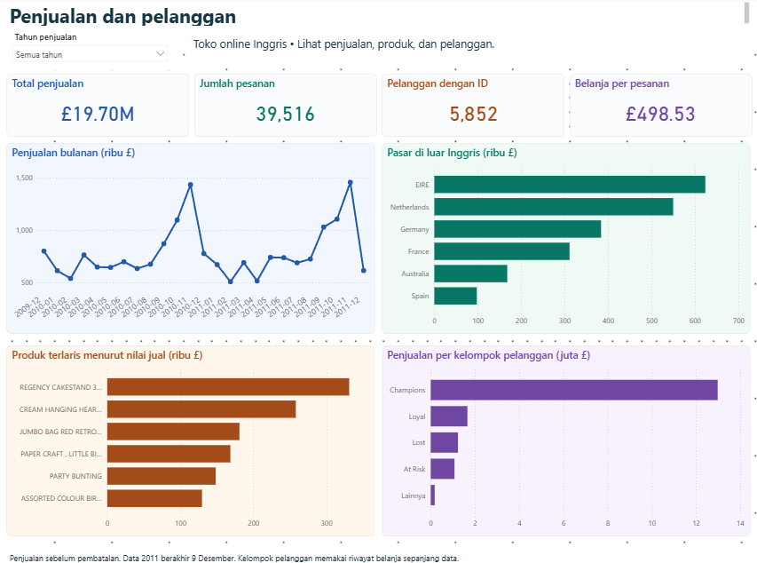

# Business Performance Analytics

Tiga studi kasus menggunakan Python dan Power BI untuk menilai risiko proyek, memahami pola penjualan, dan menjelaskan selisih laba terhadap anggaran. Setiap studi kasus dilengkapi dashboard, tabel ringkasan, rumus DAX, serta contoh pemeriksaan angka.

| Studi kasus | Pertanyaan utama | Jelajahi |
|---|---|---|
| Risiko Proyek New York | Proyek mana yang perlu diperiksa lebih dulu karena jadwalnya mundur atau anggarannya naik? | [Buka proyek](docs/01-risiko-proyek/) |
| Penjualan dan Pelanggan | Pasar mana yang menyumbang penjualan terbesar dan pasar ekspor mana yang layak diuji? | [Buka proyek](docs/02-penjualan-pelanggan/) |
| Kinerja Keuangan | Apa yang menjelaskan selisih antara laba operasi aktual dan anggaran? | [Buka proyek](docs/03-kinerja-keuangan/) |

## Cara membuka dashboard

Pilih **Buka proyek**, lalu **Dashboard Power BI**. Unduh file melalui **Download raw file**, buka di Power BI Desktop untuk Windows, lalu klik **Refresh now** jika diminta. Setiap template memuat satu dashboard dengan slicer sendiri. Untuk menyimpan laporan yang sudah terbuka, pilih **File → Save As** dan simpan sebagai PBIX.

## Isi portofolio

- [data](data/) — tabel ringkasan yang digunakan di laporan dan tautan ke data asli.
- [docs](docs/) — dokumentasi proyek, temuan, gambar ringkasan, dan dashboard.
- [scripts](scripts/) — rumus DAX dan pemeriksaan angka yang dapat dijalankan ulang.

## Analisis Python dari data asli

| Proyek | Kode | Hasil hitung |
|---|---|---|
| Risiko proyek | [risiko.py](scripts/risiko.py) | [Jadwal per periode](hasil/risiko.csv) |
| Penjualan | [penjualan.py](scripts/penjualan.py) | [Pesanan dan penjualan per tahun](hasil/penjualan.csv) |
| Keuangan | [keuangan.py](scripts/keuangan.py) | [Rekonsiliasi laba aktual dan anggaran](hasil/keuangan.csv) |

Skrip menghitung ulang angka utama dari sumber asli sebagai pembanding dashboard.
Template Power BI menggunakan ringkasan yang sudah tertanam. Menjalankan Python
memperbarui CSV di folder hasil. Untuk menjalankan kode di Windows,
ikuti [petunjuk praktik](scripts/README.md).
