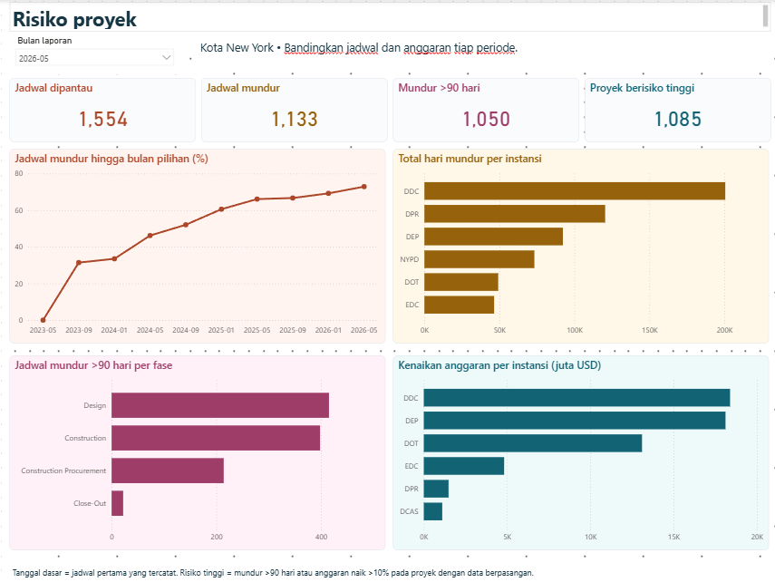

# Risiko Proyek New York

Mei 2026

*Gambar menunjukkan ringkasan pada periode acuan. Untuk menggunakan saringan, buka template di bawah.*

[Dashboard Power BI](dashboard.pbit) · [Tabel pendukung](../../data/01-risiko-proyek/) · [Rumus DAX](../../scripts/01-risiko-proyek.dax)

## Masalah bisnis

Proyek mana yang perlu diperiksa lebih dulu karena jadwalnya mundur atau anggarannya naik?

## Proses

Tanggal selesai dibandingkan dengan tanggal selesai pertama yang tersedia untuk PID yang sama. Nilai positif berarti jadwal mundur. Skor gabungan memakai pasangan PID dan pos anggaran FMS yang unik per periode.

## Temuan dan rekomendasi

Sebanyak 1.050 dari 1.554 jadwal yang dipantau mundur lebih dari 90 hari. Fase desain mencakup 415 jadwal dalam kelompok ini. Prioritaskan pemeriksaan target selesai pada proyek fase desain yang masih berstatus perkiraan.

## Cara menguji

Pilih bulan 2026-05. Kartu jumlah jadwal, jadwal mundur, dan mundur >90 hari masing-masing seharusnya menunjukkan 1.554, 1.133, dan 1.050.

## Batasan

Baseline adalah tanggal pertama dalam riwayat yang tersedia. Proyek tanpa pasangan anggaran yang unik tidak masuk perhitungan risiko gabungan.

## Sumber

[Riwayat jadwal](https://data.cityofnewyork.us/d/95tx-snak) · [Riwayat anggaran](https://data.cityofnewyork.us/d/qj5n-h5qp) · [Pemetaan jadwal dan anggaran](https://data.cityofnewyork.us/d/fb86-vt7u) — NYC Open Data.

[Kembali ke daftar proyek](../../README.md)

## Perhitungan Python dari data asli

[Lihat skrip](../../scripts/risiko.py) · [Lihat hasil CSV](../../hasil/risiko.csv)
