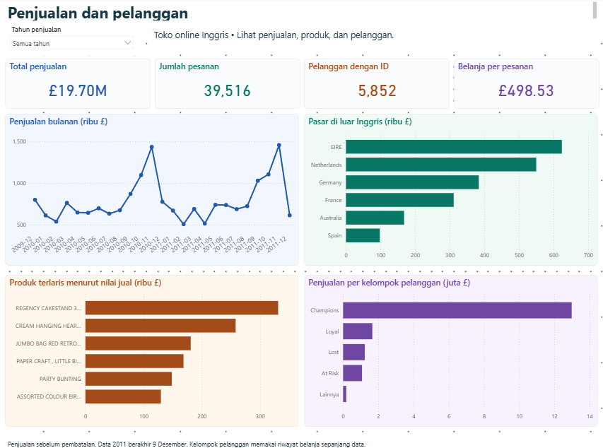

# Penjualan dan Pelanggan

Desember 2009–Desember 2011

*Gambar menunjukkan ringkasan pada periode acuan. Untuk menggunakan saringan, buka template di bawah.*

[Dashboard Power BI](dashboard.pbit) · [Tabel pendukung](../../data/02-penjualan-pelanggan/) · [Rumus DAX](../../scripts/02-penjualan-pelanggan.dax)

## Masalah bisnis

Pasar mana yang menyumbang penjualan terbesar dan pasar ekspor mana yang layak diuji?

## Proses

Dua lembar transaksi dipisahkan pada 1 Desember 2010 agar tanggal yang beririsan tidak dihitung dua kali. Penjualan memakai harga dan kuantitas positif, kode dengan lima digit awal, dan struk tanpa awalan C. Pesanan dihitung dari nomor struk unik.

## Temuan dan rekomendasi

Inggris menyumbang 85,56% nilai penjualan barang. Di luar Inggris, Irlandia (EIRE) dan Belanda mencatat nilai jual tertinggi. Jaga ketersediaan produk terlaris di Inggris dan uji promosi ekspor dalam skala kecil di Irlandia dan Belanda.

## Cara menguji

Ganti Semua tahun ke 2010. Jumlah pesanan seharusnya berubah dari 39.516 menjadi 19.627. Grafik bulanan untuk pilihan 2010 menampilkan Januari–Desember.

## Batasan

Nilai penjualan dihitung sebelum pembatalan. Desember 2011 hanya sampai tanggal 9. Pembeli tanpa ID tetap masuk nilai penjualan dan tidak masuk pengelompokan pelanggan.

## Sumber

Chen, D. (2012). [Online Retail II](https://doi.org/10.24432/C5CG6D). UCI Machine Learning Repository. [CC BY 4.0](https://creativecommons.org/licenses/by/4.0/). Data di sini telah dibersihkan dan diringkas.

[Kembali ke daftar proyek](../../README.md)

## Perhitungan Python dari data asli

[Lihat skrip](../../scripts/penjualan.py) · [Lihat hasil CSV](../../hasil/penjualan.csv)
