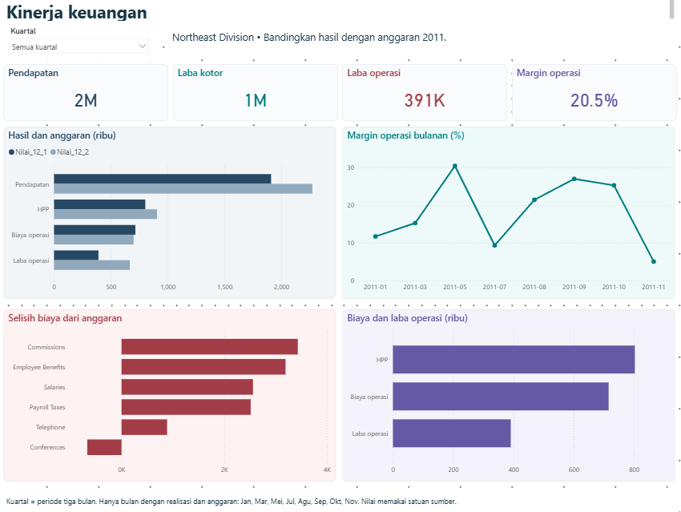

# Kinerja Keuangan

Northeast Division, 2011

*Gambar menunjukkan ringkasan pada periode acuan. Untuk menggunakan saringan, buka template di bawah.*

[Dashboard Power BI](dashboard.pbit) · [Tabel pendukung](../../data/03-kinerja-keuangan/) · [Rumus DAX](../../scripts/03-kinerja-keuangan.dax)

## Masalah bisnis

Apa yang menjelaskan selisih antara laba operasi aktual dan anggaran?

## Proses

Realisasi dan anggaran dibandingkan pada bulan yang sama. Akun rincian dikelompokkan menjadi pendapatan, harga pokok penjualan, dan biaya operasi. Retur serta diskon mengurangi pendapatan.

## Temuan dan rekomendasi

Laba operasi mencapai 390.894 dari target 666.850. Pendapatan di bawah anggaran sebesar 362.826, sedangkan biaya operasi melebihi anggaran sebesar 16.131. Telusuri selisih pendapatan terlebih dahulu, lalu periksa akun biaya dengan penyimpangan terbesar.

## Cara menguji

Pilih Semua kuartal. Rekonsiliasi laba operasi: 1.908.874 − 802.499 − 715.481 = 390.894.

## Batasan

Data fiktif. Hanya Januari, Maret, Mei, Juli, Agustus, September, Oktober, dan November yang sebanding. Semua nominal memakai satuan sumber.

## Sumber

Microsoft. [AdventureWorksDW](https://github.com/microsoft/sql-server-samples/tree/master/samples/databases/adventure-works/data-warehouse-install-script). Tabel FactFinance dan dimensi akun, organisasi, departemen, serta skenario.

[Kembali ke daftar proyek](../../README.md)

## Perhitungan Python dari data asli

[Lihat skrip](../../scripts/keuangan.py) · [Lihat hasil CSV](../../hasil/keuangan.csv)
